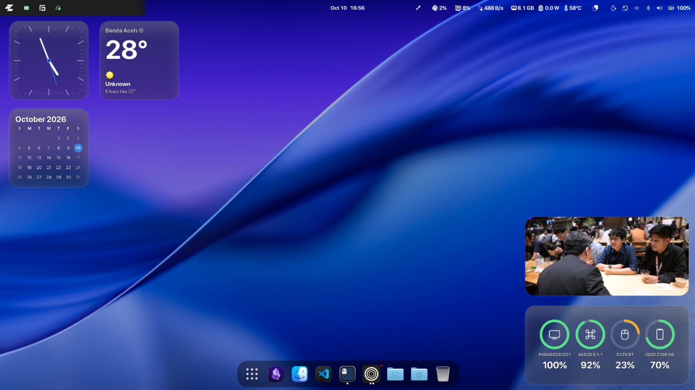

# Desktop Widget for GNOME Shell

[](#requirements) [](LICENSE) [](https://github.com/SamVivan1/samvivan-gnome-widget/releases)

A lightweight desktop widget suite for GNOME Shell 50. Forked from `widgets@distro.com`, it lives directly on your desktop layer with full drag/resize controls and a comprehensive settings panel.



## Features

- **Clock** – Clean digital time display
- **Calendar** – Month view at a glance, with a dot under every day that has events (1–3 dots, bar for more)
- **Agenda** – Today's schedule and the upcoming week from your Evolution/Online Accounts calendars, with public holidays highlighted. Resize it to show more or fewer days.
- **Weather** – Uses GNOME Weather locations
- **Photos** – Rotate local images or random photos from your Immich library, with automatic fallback. Supports all photos, favorites-only, or a specific album. Configurable interval and image quality.
- **Battery** – System battery + GSConnect phone battery (when available). Devices slide in from the right when they connect and drop away when they disconnect, keeping a stable connect order (respects GNOME reduce-motion).
- **Bambu Lab** – Live 3D printer progress (state, file, remaining time, layer, temperatures, AMS) from a self-hosted bridge that talks to your printer over the LAN
- **Placement** – Drag, resize, snap-to-grid, configurable grid gap, multi-monitor support (`-1` = primary)
- **Behavior** – Edit/Hide-all modes, widget opacity (10–100%), optional top-panel icon
- **Panel menu** – Quick toggle/edit/add/reset widgets from the top bar

## Requirements

- GNOME Shell 50
- `glib-compile-schemas` (usually present on Linux distros with GNOME)
- For Immich: a running Immich server + API key
- For Bambu Lab: the self-hosted `homelab/bambu-bridge` service reachable over HTTP(S) (see [Bambu Lab Setup](#bambu-lab-setup))
- For Calendar/Agenda events: `python3-gi` and the Evolution Data Server introspection packages (see below). Without them the widgets still work but only as a plain month view / empty agenda.

### Calendar data (optional)

Installing these enables events from GNOME Calendar, Evolution, and online accounts
(Google/Microsoft 365):

```bash
sudo apt install python3-gi gir1.2-ecal-2.0 gir1.2-edataserver-1.2 gir1.2-ical-3.0
```

Events are read through a small helper process (`tools/eds_events.py`). A separate
process is used on purpose: importing Evolution Data Server inside GNOME Shell
crashes the shell when those objects are freed.

## Installation

### 1) One-liner (recommended)

```bash
curl -fsSL https://raw.githubusercontent.com/SamVivan1/samvivan-gnome-widget/main/install.sh | bash
```

Options:
- `--force` to reinstall over an existing install
- `--uninstall` to remove it
- `--branch <name>` to install from a different branch

### 2) From GitHub Release (.zip)

Download the latest `desktop-widget@samvivan.shell-extension.zip` from [Releases](https://github.com/SamVivan1/samvivan-gnome-widget/releases), then run:

```bash
gnome-extensions install --force desktop-widget@samvivan.shell-extension.zip
gnome-extensions enable desktop-widget@samvivan
```

### 3) From source (Makefile)

```bash
git clone https://github.com/SamVivan1/samvivan-gnome-widget.git
cd samvivan-gnome-widget
make install
```

### After installation (Wayland)

GNOME Shell on Wayland does not support `Alt+F2 → r`. **Log out and back in** after installing/enabling. After login, open the panel menu → Desktop Widget to add widgets or edit them.

## Usage

1. Log out/in after install
2. Panel menu (top bar → Desktop Widget) → `Add <Widget>` to add widgets
3. Enable `Edit Widgets` to drag and resize. Widgets can be added or removed from the Widgets page in Preferences too.
4. `Hide All Widgets` to temporarily hide everything without losing layout
5. `Reset Default Widgets` to restore defaults

## Preferences

Open preferences via: `gnome-extensions prefs desktop-widget@samvivan` or panel menu → Desktop Widget → (gear/extension settings if available).

### General
- **Monitor** – target monitor (-1 = primary)
- **Grid size** – snap grid while dragging (1–200 px)
- **Widget gap** – spacing from edges (0–200 px)
- **Snap to grid** – toggle
- **Edit/Hide all/Opacity** – behavior
- **Show panel icon** – toggle top panel button

### Photos
- **Photo source** – `Immich + local (fallback)`, `Immich only`, `Local only`
- **Change interval (minutes)** – 1–1440 minutes (default 30)
- **Immich** – Server URL, API key, scope (`All photos`, `Favorites only`, `Specific album`), album dropdown, image quality (`Preview` recommended / `Thumbnail` / `Full size`)

### Bambu Lab
- **Bridge URL** – base URL of the `bambu-bridge` service (e.g. `https://bambu.example.com`)
- **Bearer token** – shared secret matching the bridge's `API_TOKEN`
- **Refresh interval (seconds)** – 3–300 seconds (default 5)
- **Test connection** – checks the bridge `/health` endpoint and printer connectivity
- **Animated face** – when the bridge is reachable but the printer is offline (or the bridge is unreachable), show a dasai-mochi face (two big eyes + a small mouth) instead of a plain message. The face also mirrors the laptop's own vitals: chip ≥ 60 °C → flushed/panting with sweat and steam, battery ≤ 20 % (unplugged) → sleepy, charging → sparkly and happy, high CPU load → dizzy
- **Always show the face** – show it even when the printer is online or the bridge is unreachable (good for testing / decoration)
- **Show the face while printing** – replace the job details with the face so it reacts to the printer's own events: printing → content/smiling with a gentle bob, paused → worried (sweat + worried mouth), failed → panicked (alarm rings, dizzy eyes, shake), finished → happy with sparkles
- **Use system accent colour / Face colour** – colour the face with the GNOME accent or a custom colour
- **Caption** – text shown under the face (leave empty to hide; while printing this is replaced by the live state and progress)

### Developer
- **Enable developer mode** – reveals testing controls without needing real conditions (no need to stress the CPU, plug in the charger or drain the battery)
- **Cycle all moods** – with developer mode on, the Bambu face rotates through every mood (chill → hot → sleepy → charging → busy → overload → printing → paused → error → done) automatically
- **Force mood** – pin a single mood (Auto / Chill / Hot / Sleepy / Charging / Busy / Overloaded / Printing / Paused / Error / Finished) for inspection
- While the face is in developer mode, a status line under it shows the live `mood · temp · battery · load` values

### Widgets
- Per-widget visibility, X/Y, Width/Height
- Reset to default layout

## Immich Setup

1. Open Immich → Account Settings → API Keys → Create API Key (with read access)
2. In Preferences → Photos, set Server URL (e.g. `https://immich.example.com`)
3. Paste the API key (stored in dconf as plain text per-user on this system)
4. Choose scope: `all` / `favorites` / `album` (album dropdown loads automatically)
5. Set image quality and interval
6. Thumbnails are cached to `~/.cache/desktop-widget/immich/<hash>/` and pruned automatically

## Bambu Lab Setup

The Bambu Lab widget does not talk to the printer directly. A small self-hosted service (`homelab/bambu-bridge`) keeps a persistent local MQTT connection to the printer and exposes its status as JSON over HTTP. Run it on a homelab host next to the printer and expose it through a Cloudflare Tunnel:

```
printer --MQTT(LAN)--> bambu-bridge --HTTPS+token--> cloudflared --> widget
```

1. On the printer, enable **LAN mode** (Settings → Network; **Developer Mode** on newer firmware) and note the LAN IP, serial number, and 8-digit access code.
2. On the homelab host: `cd homelab/bambu-bridge && cp .env.example .env`, set `BAMBU_IP`, `BAMBU_SERIAL`, `BAMBU_ACCESS_CODE` (leave `API_TOKEN=auto`), then `docker compose up -d --build`. The bridge generates a token and prints it in the log.
3. Read the token: `docker compose logs bambu-bridge | grep -A3 "API token"`.
4. Publish it with a Cloudflare Tunnel (see the bridge README for the exact `cloudflared` commands).
5. In Preferences → Bambu Lab, set the Bridge URL (e.g. `https://bambu.example.com`) and paste the token from the log, then use **Test connection**.
6. Add the widget from the panel menu or Preferences → Widgets.

See [`homelab/bambu-bridge/README.md`](homelab/bambu-bridge/README.md) for full details (endpoints, mock mode, Docker Compose, tunnel).

## Settings keys (reference)

| Key | Type | Default | Description |
|---|---|---|---|
| `layout-json` | `s` | `''` | Serialized widget layout (JSON) |
| `monitor-index` | `i` | `-1` | Target monitor |
| `grid-size` | `i` | `20` | Snap grid size (px) |
| `widget-gap` | `i` | `14` | Edge spacing (px) |
| `snap-to-grid` | `b` | `true` | Snap while dragging |
| `hide-all` | `b` | `false` | Temporarily hide all |
| `edit-mode` | `b` | `false` | Show edit controls |
| `widget-opacity` | `i` | `100` | Opacity 10–100% |
| `show-panel-icon` | `b` | `true` | Show top panel icon |
| `photos-source` | `s` | `'mixed'` | `local`/`immich`/`mixed` |
| `photo-interval` | `i` | `1800` | Seconds between image changes |
| `immich-server-url` | `s` | `''` | Immich base URL |
| `immich-api-key` | `s` | `''` | Immich API key |
| `immich-scope` | `s` | `'all'` | `all`/`favorites`/`album` |
| `immich-album-id` | `s` | `''` | Album ID when scope=album |
| `immich-size` | `s` | `'preview'` | `thumbnail`/`preview`/`fullsize` |
| `calendar-sources` | `as` | `[]` | EDS calendar UIDs to show (empty = all enabled) |
| `bambu-endpoint-url` | `s` | `''` | Bambu bridge base URL |
| `bambu-token` | `s` | `''` | Bambu bridge bearer token |
| `bambu-refresh` | `i` | `5` | Bambu poll interval (seconds) |
| `bambu-offline-fun` | `b` | `true` | Mochi face when the printer is offline |
| `bambu-offline-always` | `b` | `false` | Always show the face (even when online) |
| `bambu-face-online` | `b` | `false` | Show the face while printing (reacts to print events) |
| `bambu-offline-color` | `s` | `''` | Face colour hex (empty = system accent) |
| `bambu-offline-caption` | `s` | `'Printer is napping…'` | Caption under the face (empty = hidden) |
| `dev-mode` | `b` | `false` | Developer mode: reveal testing controls |
| `bambu-dev-mood` | `s` | `'auto'` | Force the face mood (auto/chill/hot/sleepy/charging/busy/overload/printing/paused/error/done) |
| `bambu-dev-cycle` | `b` | `false` | Cycle through every face mood automatically |

## Uninstall

### 1) One-liner

```bash
curl -fsSL https://raw.githubusercontent.com/SamVivan1/samvivan-gnome-widget/main/uninstall.sh | bash
```

This removes the extension directory and disables it. Your saved settings and the Immich thumbnail cache are kept. To remove those too, add `--purge`:

```bash
curl -fsSL https://raw.githubusercontent.com/SamVivan1/samvivan-gnome-widget/main/uninstall.sh | bash -s -- --purge
```

### 2) Other ways

```bash
# via the installer's flag
curl -fsSL https://raw.githubusercontent.com/SamVivan1/samvivan-gnome-widget/main/install.sh | bash -s -- --uninstall

# from a local checkout
make uninstall      # removes the extension
./uninstall.sh --purge   # removes extension + settings + cache
```

> On Wayland, **log out and back in** after uninstalling so GNOME Shell drops the extension.

## Troubleshooting

- **Widgets don't appear after install**: Wayland requires logout/login. Also check `gnome-extensions list --enabled`.
- **Photos stay same / don't rotate**: Check interval and source in Preferences → Photos. For Immich, verify URL/API key reachability.
- **Immich shows "Album list unavailable"**: Server URL or API key wrong; check network/firewall. Albums load with 600ms debounce after changes.
- **Bambu widget says "Configure…"**: Set the bridge URL and token in Preferences → Bambu Lab and use **Test connection**.
- **Bambu widget shows a face / "Printer offline"**: The bridge is reachable but its MQTT link to the printer is down (or the bridge itself is unreachable) — check LAN/Developer Mode and the access code, then `docker compose logs -f` on the host. Disable the animated face (Preferences → Bambu Lab → Animated face) or toggle **Always show the face** to force/decorate it.
- **Extension crashes at enable**: Try disabling, clearing layout? If needed, reset via panel menu or clear `layout-json` in dconf (advanced).
- **Live reload on Wayland**: `Alt+F2 → r` is disabled; logout/login is the safe way.

## Development

### Structure
```
.
├── install.sh            # one-liner installer
├── uninstall.sh          # one-liner uninstaller (--purge to wipe data)
├── Makefile              # make check/test/install/uninstall/pack (+ i18n targets)
├── package.json          # node --test entry point (dev only, not packaged)
├── scripts/              # check.sh (ESM parse) + pack.py (build release zip)
├── extension.js          # GNOME Shell entry, layout/drag/resize, panel menu
├── prefs.js              # libadwaita preferences UI
├── metadata.json         # Extension metadata
├── logger.js             # Logging helpers
├── stylesheet.css        # Global styles
├── schemas/              # GSettings schema
├── po/                   # gettext translations (POTFILES.in, LINGUAS, *.po)
├── tests/                # node --test unit tests (gi-free logic)
├── lib/
│   ├── bambuData.js      # polls the Bambu bridge, caches + refreshes status
│   ├── bambuStatus.js    # pure status signature (change detection)
│   ├── calendarData.js   # runs tools/eds_events.py, caches + refreshes events
│   ├── geometry.js       # pure layout/fraction math (testable without gi)
│   └── mood.js           # pure face-mood conditions + thresholds
├── tools/
│   └── eds_events.py     # EDS -> JSON helper (separate process, avoids shell crash)
├── widgets/
│   ├── clock/            # type/label/stylesheet/defaultSize + render/cleanup/style
│   ├── calendar/         # month view + event dots
│   ├── agenda/           # today + upcoming events
│   ├── weather/
│   ├── photos/           # rotation + Immich + local sources
│   ├── battery/          # system + GSConnect
│   └── bambu/            # 3D printer progress from the bridge
├── homelab/
│   └── bambu-bridge/     # self-hosted printer bridge (Docker, not packaged)
└── workspaceIntegration.js
```

### Checks and tests
```bash
make check        # ESM parse check for every tracked .js file
make test         # node --test tests/*.test.mjs (pure logic, no gi needed)
make pot          # regenerate po/desktop-widget.pot (needs gettext)
make update-po    # merge new strings into po/*.po
make translations # compile po/*.po into locale/<lang>/LC_MESSAGES/*.mo
```
Prefer putting gi-free logic (math, parsing, thresholds) in `lib/` so it can be
covered by `node --test`. Both `make check` and the unit tests run in CI
(`.github/workflows/check.yml`).

### Widget module contract
Each widget module must export:
- `export const type = '...'`
- `export const label = '...'`
- `export const stylesheet = 'widgets/<type>/stylesheet.css'`
- `export const defaultSize = 'small'|'medium'|'large'`

And provide:
- `export function style()` (optional)
- `export function render({ ...settings })` – returns a `Clutter.Actor`/container
- `export function reconcile({ ...settings, animate })` (optional) – takes precedence over `render` for in-place updates without clearing the body; set `animate` to `false` for instant changes
- `export function cleanup(actor)` (optional)

### Adding a widget
1. Create `widgets/mywidget/{widget.js,stylesheet.css}`
2. Implement the contract above
3. Add default size to layout/extension defaults if desired
4. Add prefs entry if needed
5. `make check && make install` (or sync + logout/login)

### Testing (nested headless shell)
```bash
mkdir -p /tmp/opencode/xrt && chmod 700 /tmp/opencode/xrt
XDG_RUNTIME_DIR=/tmp/opencode/xrt dbus-run-session -- gnome-shell --headless 2>&1 | tail -30
```
(Useful to catch JS errors without breaking your live session.)

## Credits

- Forked from [`widgets@distro.com`](https://extensions.gnome.org/extension/6081/widgets/) — original concept and structure
- Immich integration, Photos rotation/fallback, GSConnect phone battery, prefs, and polish by `desktop-widget@samvivan`

## License

This is free and unencumbered software released into the public domain (see [LICENSE](LICENSE)).
